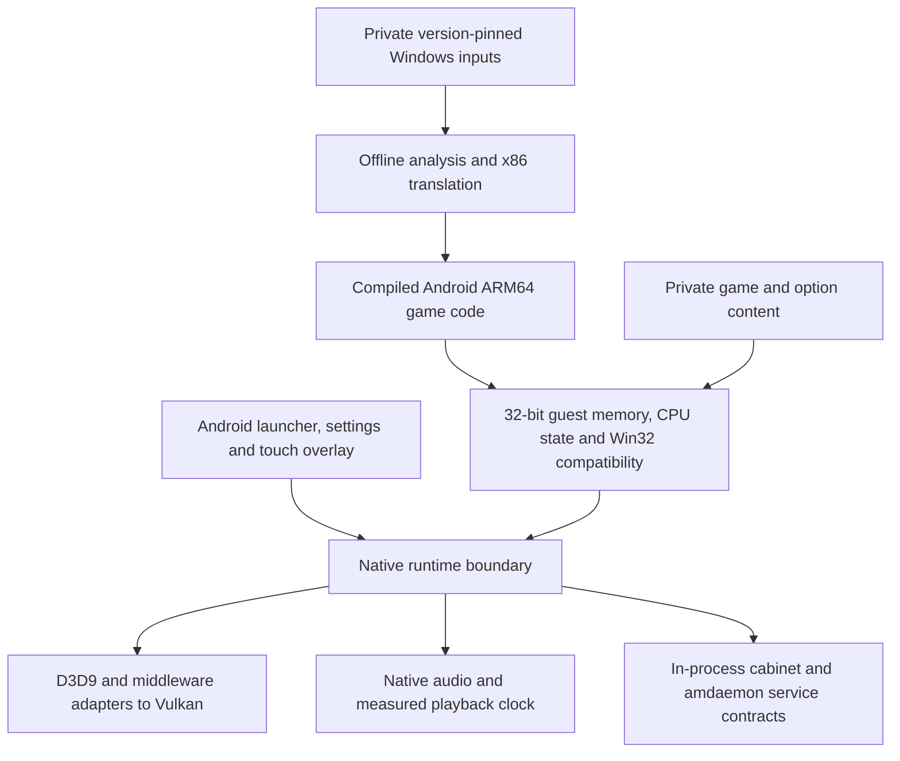

# Native Android runtime investigation

This is the start of a separate native CHUNITHM project in Winlator-Chusan.
The Windows-container overlay work is deferred. Nothing in this directory
currently boots CHUNITHM or replaces Wine in the existing Android app.

## Verified on 31 October 2026

- Read-only inspection recorded 25 top-level PE executables and DLLs from the
  local installation. The main executable is x86; amdaemon is x86-64.
- `chusanApp.exe` imports 812 functions across 35 DLLs and has a TLS directory.
  Declared dependencies include modern MSVC/UCRT, D3D9/D3DX9, Cg, E-mote,
  WinHTTP, sockets, threads and dynamically resolved APIs. Import counts are a
  lower bound: they omit COM methods and dynamically discovered interfaces.
- The main SHA-256 is
  `dcd883ddd41d6e0a26a8902d8c94dd123c5e8dd5990dd6a428e6b421195d38ca`.
  It matches neither executable recorded in the supplied iPad plan. Its game
  version is not independently established. Addresses, translated functions and
  validation results from that plan cannot be reused as evidence for this input.
- An isolated four-instruction source routine at `0x00595550` was checked on
  Windows against a bounded C translation: 4,096 input cases, zero EAX or
  defined ADD-flag mismatches. The original bytes run directly on x86 hardware.
  The emitted C also compiles to a freestanding Android AArch64 ELF object.
- A standalone ARM64 executable now embeds the 4,096 original-x86 reference
  vectors and compares the same generated C on the device. Its ADB runner
  verifies the executable hash, selects an authorized ARM64 device, records
  local device evidence and removes its temporary test executable afterwards.
- The ARM64 executable passed all 4,096 original-x86 vector comparisons on the
  connected Xiaomi `23073RPBFG`, SM6225, Android 15 / API 35. This is direct
  ARM64 execution with zero mismatches, not emulation. Evidence remains local
  in `.work/routine-probe/device-report.json`.
- A read-only system Vulkan query identified Adreno 610 and Vulkan 1.1.128.
  The stock driver's reported extension list omits requirements in the current
  DXVK profile, including `VK_KHR_maintenance5` and `VK_KHR_maintenance6`.
- The libadrenotools APK was built and tested on that tablet. Stock Vulkan
  1.1.128 reports 70 device extensions; app-local Turnip reports Vulkan
  1.3.352 and 140 extensions, including 79 absent from the stock list.
  Both created a graphics-queue logical device. A traversal-style driver name
  was rejected before loading. [Device verification](verification/device-results-2026-10-31.md).
- **Not verified:** a complete calling convention or
  fault model, function discovery, indirect control flow, SSE/x87, DLL startup,
  game boot, original graphics/audio, network/service behavior or playable speed.
  The routine comparison is not a full Android application/lifecycle test.

The profile records identities and the bounded probe only. The generated source,
original routine bytes, executable, ARM64 object and reports stay in ignored
`.work/`. No original game bytes or assets are committed.

## Architecture to investigate



Keep guest addresses as 32-bit values and translate them through a validated
memory arena; never cast them to Android host pointers. Unsupported calls and
untranslated destinations must produce explicit diagnostics. Successful-looking
placeholder services are not a working runtime. The native service adapter is
a new implementation; replacing amdaemon removes the need to translate that
x86-64 process, but its observed interfaces still have to be reproduced.

The iPad design provides useful boundaries and acceptance criteria. UIKit,
Metal and the iOS audio/lifecycle implementation do not carry over. The Android
host target is NDK `arm64-v8a` with Vulkan and a native audio backend. Oboe is
a candidate for Android audio; it does not decode CRI content or establish the
game's audio clock by itself. Device capability and latency probes come first.

For input, retain the requested top-aligned 16:9 image, calibrated narrower
GROUND SLIDER, full-width six-band Sensing Range, transparent ground interiors,
LEDs clipped below the image, and modal input cancellation with fresh-touch
resumption. The game/service boundary should receive direct native input;
Brokenithm remains a behavior/protocol reference for the deferred Winlator route.

## Reuse assessment

| Candidate | Relevant existing work | Remaining CHUNITHM work |
| --- | --- | --- |
| recomp-kit, inspected commit `487b94ac17bc10c4796dc4bce8d16ddbdeb7ec1d` | x86-to-C translator, guest memory/loader, Win32 shims, Android/SDL3 target | Its documented first-version scope excludes shader-model D3D8/9. The inspected DirectX adapters are for older interfaces. D3D9/Cg/E-mote, this compiler/runtime, services and timing need separate qualification. Not adopted yet. |
| Remill | x86 instruction lifting to LLVM bitcode | Not an application compatibility layer; needs discovery, ABI bridges, runtime, graphics, audio and services. |
| McSema | binary control-flow recovery and lifting tooling | Upstream repository is archived; not the default foundation for a new port. |
| DXVK Native | D3D9/11 translation to Vulkan without Wine; SDL3/SDL2/GLFW presentation seams | Native Android build, device/driver features and 32-bit guest COM to 64-bit host bridges must be proven. Desktop/native support is not proof of Android compatibility. |

Starting the project from scratch does not require writing every library from
scratch. Qualify a reusable translator/runtime before committing to either a
custom implementation or a fork. The current probe intentionally supports one
small instruction pattern and is not that translator selection.

## Next observable gates

1. Expand the completed isolated ARM64 routine proof beyond its four-instruction
   pattern; retain the original-x86 vector and device identity evidence.
2. Qualify a translation foundation with real routines covering memory,
   branches, indirect callbacks, integer flags and floating point. Fail on an
   unknown instruction or target rather than accepting a silent stub.
3. Establish the pinned game's entry/CRT/TLS/DLL startup closure and implement
   the contracts it actually reaches. Record missing addresses and imports.
4. Prove one original D3D9 draw and a sound-content path on Android. A native
   clear or silence-only audio fixture is a separate, smaller result.
5. Reproduce the observed cabinet/service boundary and connect the native
   overlay, LEDs, card and credit actions. Keep account configuration private.
6. Complete a real chart and validate audio clock, frame pacing, interruptions,
   saved state and sustained thermal behavior on the target tablet.

Snapdragon 680 / Adreno 610 performance is unknown. Ahead-of-time compilation
does not establish native-source speed, 60 FPS or accurate rhythm timing.

## Reproduce the tooling checks

From the repository root, with Python 3.12 or later:

```powershell
python -m venv native-runtime/.venv
native-runtime/.venv/Scripts/python -m pip install -r native-runtime/requirements.txt
native-runtime/.venv/Scripts/python -m unittest discover -s native-runtime/tests -v
native-runtime/.venv/Scripts/python native-runtime/tools/inventory.py --bin-dir '<private game bin>' --profile native-runtime/profiles/chusan-local-dcd883dd.json --output native-runtime/.work/inventory.json
```

On Linux/macOS use `native-runtime/.venv/bin/python`. The inventory refuses
writing into the source installation; a profile mismatch exits with status 2.
It scans top-level PE files only and does not claim a complete dependency graph.

The isolated hardware-reference generator currently needs Windows and llvm-mingw
(tested with clang 23.1.4). All generated output stays outside the game folder:

```powershell
native-runtime/.venv/Scripts/python native-runtime/tools/probe_routine.py --exe '<private game bin>/chusanApp.exe' --profile native-runtime/profiles/chusan-local-dcd883dd.json --clang '<llvm-mingw>/bin/clang.exe' --output native-runtime/.work/routine-probe
native-runtime/.venv/Scripts/python native-runtime/tools/test_device.py --probe-dir native-runtime/.work/routine-probe
```

For multiple connected devices, add `--serial <adb serial>` to the second
command. USB debugging must be enabled and this computer authorized. The ADB
test uses a temporary path under `/data/local/tmp/`; it installs no APK and
does not copy game assets or change Android settings. It is an ARM64 shell
correctness fixture, not proof of an Android application lifecycle or full boot.
Host evidence is in `report.json`; successful device evidence is written
separately to `device-report.json` under the chosen ignored probe directory.

## Optional Vulkan drivers through libadrenotools

The separate `android/` project builds a small diagnostic APK with the native
loader in `platform/android/`. It pins libadrenotools to
`8483dfdaa2abf97ee89ad0e5f337e7b508550c6b`, including its pinned linkernsbypass
submodule. It loads the system driver or an app-private custom driver before
creating a Vulkan instance, uses that handle's entry points, reports the actual
driver identity/extensions, and attempts a graphics-queue logical device.
It does not render a frame or establish DXVK compatibility.

Hook libraries are extracted using legacy JNI packaging. The hook path comes
from `ApplicationInfo.nativeLibraryDir`; custom drivers must be under the
app's private `files/driver/` directory. No system driver, root setting or global
GPU configuration is changed. A custom-load error is explicit; a matching stock
identity is not reported as a successfully replaced driver. Test each driver
in a fresh process because Vulkan/hook state must not be switched under live
objects. Dependency notices are included in the APK assets.

Build independently of the Winlator app from the repository root:

```powershell
.\gradlew.bat -p native-runtime/android assembleDebug
python native-runtime/tools/test_vulkan_driver.py --apk '<probe-debug.apk>' --driver app/src/main/assets/graphics_driver/adrenotools-turnip26.2.0.tzst --output native-runtime/.work/vulkan-drivers.json
```

The Android SDK and NDK 27.2.12479018 are required for a local APK build; CI
publishes `Android-driver-probe`. The test runner needs Python 3.14 for `.tzst`
packages, or Python 3.12+ for driver ZIPs. It validates archive paths and ELF
architecture, installs only the diagnostic APK, stages the selected driver in
that app's sandbox through debug `run-as`, and probes both modes separately.
The existing repository Turnip package is a test candidate, not a promise of
Adreno 610 support on every device; it loaded successfully on the connected
tablet. Extra extensions depend on the loaded driver, not on
libadrenotools alone; device identity and actual capabilities govern the result.

The host runner invokes only the validated nine-byte isolated routine, not
the game entry point or DLL initializers. It compares EAX and six defined
arithmetic flags for fixed boundary and deterministic random inputs. It does
not establish complete x86 semantics, the original routine's caller behavior,
an Android ABI bridge, graphics, audio or full-game translation.

## Primary references

- [recomp-kit](https://github.com/veritr1x/recomp-kit) and its
  [first-version exclusions](https://github.com/veritr1x/recomp-kit/blob/487b94ac17bc10c4796dc4bce8d16ddbdeb7ec1d/docs/superpowers/specs/2026-09-13-recomp-kit-design.md).
- [Remill](https://github.com/lifting-bits/remill) and
  [McSema](https://github.com/lifting-bits/mcsema).
- [DXVK Native](https://github.com/doitsujin/dxvk#dxvk-native).
- [Android ABIs](https://developer.android.com/ndk/guides/abis),
  [Vulkan](https://developer.android.com/ndk/guides/graphics),
  [Oboe](https://developer.android.com/games/sdk/oboe).
- [Snapdragon 680 specifications](https://www.qualcomm.com/content/dam/qcomm-martech/dm-assets/documents/product_brief_-_snapdragon_680_4g_mobile_platform.pdf).

The supplied iPad plan was used as an architectural reference. Its source code
is unavailable here; none of its reported execution checks were rerun or adopted.
