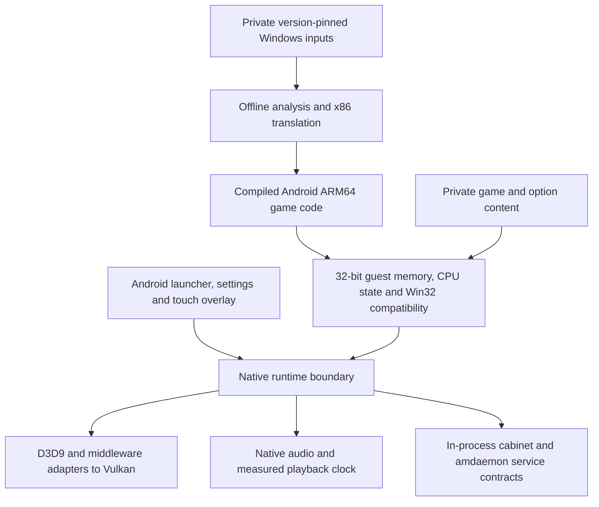

# Native Android runtime investigation

This is the start of a separate native CHUNITHM project in Winlator-Chusan.
The Windows-container overlay work is deferred. Nothing in this directory
currently boots CHUNITHM or replaces Wine in the existing Android app.

## Verified on 31 October–1 November 2026

- Read-only inspection recorded 25 top-level PE executables and DLLs from the
  local installation. The main executable is x86; amdaemon is x86-64.
- `chusanApp.exe` imports 812 functions across 35 DLLs and has a TLS directory.
  Declared dependencies include modern MSVC/UCRT, D3D9/D3DX9, Cg, E-mote,
  WinHTTP, sockets, threads and dynamically resolved APIs. Import counts are a
  lower bound: they omit COM methods and dynamically discovered interfaces.
- The main SHA-256 is
  `dcd883ddd41d6e0a26a8902d8c94dd123c5e8dd5990dd6a428e6b421195d38ca`.
  It matches neither executable recorded in the supplied iPad plan. Its game
  version is not independently established. Addresses, translated functions and
  validation results from that plan cannot be reused as evidence for this input.
- An isolated four-instruction source routine at `0x00595550` was checked on
  Windows against a bounded C translation: 4,096 input cases, zero EAX or
  defined ADD-flag mismatches. The original bytes run directly on x86 hardware.
  The emitted C also compiles to a freestanding Android AArch64 ELF object.
- A standalone ARM64 executable now embeds the 4,096 original-x86 reference
  vectors and compares the same generated C on the device. Its ADB runner
  verifies the executable hash, selects an authorized ARM64 device, records
  local device evidence and removes its temporary test executable afterwards.
- The ARM64 executable passed all 4,096 original-x86 vector comparisons on the
  connected Xiaomi `23073RPBFG`, SM6225, Android 15 / API 35. This is direct
  ARM64 execution with zero mismatches, not emulation. Evidence remains local
  in `.work/routine-probe/device-report.json`.
- A read-only system Vulkan query identified Adreno 610 and Vulkan 1.1.128.
  The stock driver's reported extension list omits requirements in the current
  DXVK profile, including `VK_KHR_maintenance5` and `VK_KHR_maintenance6`.
- The libadrenotools APK was built and tested on that tablet. Stock Vulkan
  1.1.128 reports 70 device extensions; app-local Turnip reports Vulkan
  1.3.352 and 140 extensions, including 79 absent from the stock list.
  Both created a graphics-queue logical device. A traversal-style driver name
  was rejected before loading. [Device verification](verification/device-results-2026-10-31.md).
- The first startup initializer at `0x00e3d42f` now passes 4,096 original-x86
  vector comparisons with recomp-kit-generated C on Windows x64 and physical
  Android ARM64, with zero mismatches. All seven unknown-target/API/return and
  invalid-memory checks terminate explicitly on both platforms.
  [Exact scope and identities](verification/startup-initializer-2026-10-31.md).
- The supplied SDEZ reference includes real managed `AMWithoutDaemon.NET`
  behavior for credits, cards, backup and IO. It is useful reference material;
  its managed interfaces do not implement the native CHUNITHM IPC/ABI.
  [Service replacement assessment](verification/service-reference-2026-10-31.md).
- The first bounded runtime checkpoint executed the actual entry/CRT path and first two C
  initializer callbacks. Windows x64 and physical ARM64 both reach
  `CreateEventW` after 271 blocks and 21 native API calls. This is a partial
  startup checkpoint; [scope and identities](verification/startup-bringup-2026-10-31.md).
- An earlier expanded runtime completed all four C initializers and 425 C++ callbacks
  on both Windows and the physical tablet. Both execute 27,089 block visits
  and 1,679 import dispatches before the next untranslated constructor.
  [Startup evidence](verification/constructor-runtime-2026-11-01.md).
  All 35 tooling tests and 40 synthetic scenarios pass. The selected-driver
  GPU test also passes all 16 pixels with stock and Turnip.
  [Graphics evidence](verification/vulkan-draw-2026-11-01.md).
- The latest runtime completes all four C and 959 C++ callbacks on Windows and
  physical ARM64, with identical 65,870 block visits and 3,151 API dispatches.
  Both stop at `GetStartupInfoW` in the remaining CRT startup path. This includes
  a scalar MOVSD translation fix, native exception message ownership and two
  explicit unavailable filesystem export queries.
  [Complete initializer evidence](verification/startup-963-initializers-2026-11-01.md).
- **Not verified:** a complete calling convention or
  fault model, function discovery, indirect control flow, SSE/x87, DLL startup,
  game boot, original graphics/audio, network/service behavior or playable speed.
  The routine comparison is not a full Android application/lifecycle test.

The profile records identities and the bounded probe only. The generated source,
original routine bytes, executable, ARM64 object and reports stay in ignored
`.work/`. No original game bytes or assets are committed.

## Architecture to investigate



Keep guest addresses as 32-bit values and translate them through a validated
memory arena; never cast them to Android host pointers. Unhandled calls and
untranslated destinations must produce explicit diagnostics. Optional operations
may use documented, counted stubs under [the stub policy](PLAN.md#stub-policy).
Keep coherent state for credits, cards, saves, input and timing. The native
service adapter is a new implementation; replacing amdaemon removes the need to translate that
x86-64 process, but its observed interfaces still have to be reproduced.

The iPad design provides useful boundaries and acceptance criteria. UIKit,
Metal and the iOS audio/lifecycle implementation do not carry over. The Android
host target is NDK `arm64-v8a` with Vulkan and a native audio backend. Oboe is
a candidate for Android audio; it does not decode CRI content or establish the
game's audio clock by itself. Device capability and latency probes come first.

For input, retain the requested top-aligned 16:9 image, calibrated narrower
GROUND SLIDER, full-width six-band Sensing Range, transparent ground interiors,
LEDs clipped below the image, and modal input cancellation with fresh-touch
resumption. The game/service boundary should receive direct native input;
Brokenithm remains a behavior/protocol reference for the deferred Winlator route.

## Reuse assessment

| Candidate | Relevant existing work | Remaining CHUNITHM work |
| --- | --- | --- |
| recomp-kit, inspected commit `487b94ac17bc10c4796dc4bce8d16ddbdeb7ec1d` | x86-to-C emitter, guest memory/loader, Win32 shims, Android/SDL3 target; current code includes D3D9 and shaders | One real startup initializer qualified with eager flags and a strict consumer fixture. Complete runtime not adopted: interpreter fallbacks, unresolved-import defaults and permissive returns need removal from qualification paths. D3D9/Cg/E-mote, CRT/DLL startup, floating point and timing remain unproved. |
| Remill | x86 instruction lifting to LLVM bitcode | Not an application compatibility layer; needs discovery, ABI bridges, runtime, graphics, audio and services. |
| McSema | binary control-flow recovery and lifting tooling | Upstream repository is archived; not the default foundation for a new port. |
| DXVK Native | D3D9/11 translation to Vulkan without Wine; SDL3/SDL2/GLFW presentation seams | Native Android build, device/driver features and 32-bit guest COM to 64-bit host bridges must be proven. Desktop/native support is not proof of Android compatibility. |

Starting the project from scratch does not require writing every library from
scratch. The first four-instruction probe used a tiny custom emitter; the newer
startup fixture consumes the pinned recomp-kit emitter and instruction header.
This qualification does not adopt its complete runtime.

## Next observable gates

Follow [the implementation plan](PLAN.md). The bounded first-startup gate is
complete. Next qualify source-selected loops/callbacks/floating point and the
actual CRT/TLS closure, while recovering the CHUNITHM service boundary. Qualify
the existing D3D9 backend early. Then close original content/audio and native
services before playable chart and sustained timing checks.

Snapdragon 680 / Adreno 610 performance is unknown. Ahead-of-time compilation
does not establish native-source speed, 60 FPS or accurate rhythm timing.

## Reproduce the tooling checks

From the repository root, with Python 3.12 or later:

```powershell
python -m venv native-runtime/.venv
native-runtime/.venv/Scripts/python -m pip install -r native-runtime/requirements.txt
native-runtime/.venv/Scripts/python -m unittest discover -s native-runtime/tests -v
native-runtime/.venv/Scripts/python native-runtime/tools/inventory.py --bin-dir '<private game bin>' --profile native-runtime/profiles/chusan-local-dcd883dd.json --output native-runtime/.work/inventory.json
```

On Linux/macOS use `native-runtime/.venv/bin/python`. The inventory refuses
writing into the source installation; a profile mismatch exits with status 2.
It scans top-level PE files only and does not claim a complete dependency graph.

The isolated hardware-reference generator currently needs Windows and llvm-mingw
(tested with clang 23.1.4). All generated output stays outside the game folder:

```powershell
native-runtime/.venv/Scripts/python native-runtime/tools/probe_routine.py --exe '<private game bin>/chusanApp.exe' --profile native-runtime/profiles/chusan-local-dcd883dd.json --clang '<llvm-mingw>/bin/clang.exe' --output native-runtime/.work/routine-probe
native-runtime/.venv/Scripts/python native-runtime/tools/test_device.py --probe-dir native-runtime/.work/routine-probe
```

For multiple connected devices, add `--serial <adb serial>` to the second
command. USB debugging must be enabled and this computer authorized. The ADB
test uses a temporary path under `/data/local/tmp/`; it installs no APK and
does not copy game assets or change Android settings. It is an ARM64 shell
correctness fixture, not proof of an Android application lifecycle or full boot.
Host evidence is in `report.json`; successful device evidence is written
separately to `device-report.json` under the chosen ignored probe directory.

## Optional Vulkan drivers through libadrenotools

The separate `android/` project builds a small diagnostic APK with the native
loader in `platform/android/`. It pins libadrenotools to
`8483dfdaa2abf97ee89ad0e5f337e7b508550c6b`, including its pinned linkernsbypass
submodule. It loads the system driver or an app-private custom driver before
creating a Vulkan instance, uses that handle's entry points, reports the actual
driver identity/extensions, creates a graphics-queue logical device, draws a
4x4 triangle and verifies every pixel through a staging-buffer readback.
Both stock and custom drivers passed on the target tablet.
[Draw verification](verification/vulkan-draw-2026-11-01.md).
An optional kit-translated D3D9 pixel shader also passes compilation and 16/16
pixel readback with both drivers. [Shader verification](verification/d3d9-shader-2026-11-01.md).
Full D3D9 and DXVK compatibility remain unverified.

Hook libraries are extracted using legacy JNI packaging. The hook path comes
from `ApplicationInfo.nativeLibraryDir`; custom drivers must be under the
app's private `files/driver/` directory. No system driver, root setting or global
GPU configuration is changed. A custom-load error is explicit; a matching stock
identity is not reported as a successfully replaced driver. Test each driver
in a fresh process because Vulkan/hook state must not be switched under live
objects. Dependency notices are included in the APK assets.

Build independently of the Winlator app from the repository root:

```powershell
.\gradlew.bat -p native-runtime/android assembleDebug
python native-runtime/tools/test_vulkan_driver.py --apk '<probe-debug.apk>' --driver app/src/main/assets/graphics_driver/adrenotools-turnip26.2.0.tzst --output native-runtime/.work/vulkan-drivers.json
```

Set `RECOMP_KIT_ROOT` to a clean checkout of the pinned kit (or pass
`-PrecompKitRoot=<path>`) to build the translated D3D9 pixel shader proof.
Then add `--require-d3d9` to the device test. It requires shader compilation and
complete green pixel evidence separately from the generic red draw. glslang is
pinned to `e1b562a8bed273a02f30b59b66a5d499793cede5` (16.6.0).

The Android SDK and NDK 27.2.12479018 are required for a local APK build; CI
publishes `Android-driver-probe`. The test runner needs Python 3.14 for `.tzst`
packages, or Python 3.12+ for driver ZIPs. It validates archive paths and ELF
architecture, installs only the diagnostic APK, stages the selected driver in
that app's sandbox through debug `run-as`, and probes both modes separately.
The existing repository Turnip package is a test candidate, not a promise of
Adreno 610 support on every device; it loaded successfully on the connected
tablet. Extra extensions depend on the loaded driver, not on
libadrenotools alone; device identity and actual capabilities govern the result.

The host runner invokes only the validated nine-byte isolated routine, not
the game entry point or DLL initializers. It compares EAX and six defined
arithmetic flags for fixed boundary and deterministic random inputs. It does
not establish complete x86 semantics, the original routine's caller behavior,
an Android ABI bridge, graphics, audio or full-game translation.

## Reproduce the first startup initializer qualification

Use a clean checkout of the pinned recomp-kit commit, llvm-mingw and NDK 27.2:

```powershell
python native-runtime/tools/probe_startup.py --exe '<private game bin>/chusanApp.exe' --kit '<recomp-kit checkout>' --clang '<llvm-mingw>/bin/clang.exe' --android-clang '<NDK>/toolchains/llvm/prebuilt/windows-x86_64/bin/aarch64-linux-android29-clang.cmd' --output native-runtime/.work/startup-probe
python native-runtime/tools/test_startup_device.py --probe-dir native-runtime/.work/startup-probe --adb '<platform-tools>/adb.exe' --serial '<adb serial>'
```

The Windows x86 oracle executes only the hash-pinned 156-byte routine. Four
deterministic fixture APIs supply all external inputs. Generated code and all
reference records stay under ignored `.work/`; no original bytes are published.
The Android runner verifies artifact identities, copies the executable/vectors
to a temporary device directory, compares all 4,096 records, checks seven
terminal failures and removes the temporary files. This is a shell fixture,
not an Android application or an original full-startup run.

## Run bounded original entry/CRT startup

`runtime/` now provides a small AOT block dispatcher and initial native Win32/CRT
adapters. `prepare_runtime.py` follows direct control flow from the pinned PE
entry, emits compiled C, maps the original sections and IAT, and records pending
targets/translation guards. Additional roots must come from inspected code or
data-driven callbacks. The two initializer tables below contain four C and 959
C++ callbacks. The ILT range is a validated sequence of 92,112 relative jumps;
only thunk pointers actually used as immediates in admitted code seed further
discovery. The extra guard thunk was observed during execution:

```powershell
python native-runtime/tools/prepare_runtime.py --exe '<private game bin>/chusanApp.exe' --kit '<pinned recomp-kit checkout>' --output native-runtime/.work/startup-expanded --max-blocks 28000 --init-table 0x172d8d8:0x172ddec --init-table 0x172c000:0x172d7d4 --ilt-range 0x401005:0x471715 --root 0x41dd86
python native-runtime/tools/prepare_runtime.py --exe '<private game bin>/chusanApp.exe' --kit '<pinned recomp-kit checkout>' --output native-runtime/.work/startup-expanded --max-blocks 44000 --init-table 0x172d8d8:0x172ddec --init-table 0x172c000:0x172d7d4 --ilt-range 0x401005:0x471715 --root 0x41dd86 --retain-report native-runtime/.work/startup-expanded/preparation.json
python native-runtime/tools/run_runtime.py --prepare-dir native-runtime/.work/startup-expanded --kit '<pinned recomp-kit checkout>' --clang '<llvm-mingw>/bin/clang.exe' --android-clang '<NDK>/toolchains/llvm/prebuilt/windows-x86_64/bin/aarch64-linux-android29-clang.cmd' --adb '<platform-tools>/adb.exe' --serial '<adb serial>'
```

The runner compiles Windows x64 and Android ARM64 versions, executes the original
entry's translated code, and records the first explicit stop. Exit zero from
the Python runner means it captured that stop; inspect `run-report.json` for the
actual missing operation. It does not mean the game booted. Private image/code
and diagnostics stay in `.work/`; temporary device files are removed.
Generated C is split into cached translation units, with a response file for
linking larger builds on Windows. Use `--host-only` without the Android arguments
when the tablet is unavailable.
Retained expansion validates the prior report's identities and keeps every
earlier block before following additional read-only callback tables. The report
is loaded before output is rewritten, so retaining the same directory is valid.

The consumer uses the pinned instruction header with bounds/permission checks
inserted into all 15 memory accessors in a private generated copy, including
accesses made by its inline helpers. The original checkout remains unchanged.
Every block edge returns to the budgeted dispatcher. Guest FS/TEB/TLS state is
initialized; host SEH instrumentation is disabled and exception dispatch remains
unsupported. The complete kit loader/import runtime/interpreter is not linked.

Native `_initterm`/`_initterm_e` use guest continuations to execute translated
callbacks, including the error-return short circuit and cdecl stack ownership.
Initial adapters provide clocks, CRT configuration, an empty process-environment
stub, baseline CPU-feature stubs and exit-callback registration. They do not yet
provide process shutdown, full locale/floating-point semantics or full CRT APIs.
Events support named sharing, reset modes and handle lifetime. Blocking event
waits still stop until guest scheduling exists. Critical sections support
recursion on the primary guest thread. Win32 TLS has separate inline/expansion
slots; it does not overwrite module static TLS. The initial guest heap supports
aligned/ordinary allocation and freeing within a 176 MiB arena, with 8,192 live
allocation records. General multithreading and the remaining CRT calls are pending.
Calendar conversion, UTF-16 bounded copying and RTTI name comparison now cover
the reached constructor calls. Calendar fixtures use UTC in their own processes;
normal startup uses the platform timezone.

Synthetic programs test loops/calls/returns, callback iteration/short circuit,
instruction budget, memory protection, 53-bit control state and SIMD data moves.
They run without game inputs and are included in CI:

```powershell
python native-runtime/tools/test_runtime.py --kit '<pinned recomp-kit checkout>' --clang '<llvm-mingw>/bin/clang.exe' --android-clang '<NDK>/toolchains/llvm/prebuilt/windows-x86_64/bin/aarch64-linux-android29-clang.cmd' --adb '<platform-tools>/adb.exe' --serial '<adb serial>'
```

These checks exercise the dispatcher and selected adapters. They are separate
from the earlier 4,096 original-x86 initializer comparisons and do not establish
full-game boot, original graphics/audio, service compatibility or speed.

## Primary references

- [recomp-kit](https://github.com/veritr1x/recomp-kit/tree/487b94ac17bc10c4796dc4bce8d16ddbdeb7ec1d).
  Current implementation takes precedence over its older design exclusions.
- [Remill](https://github.com/lifting-bits/remill) and
  [McSema](https://github.com/lifting-bits/mcsema).
- [DXVK Native](https://github.com/doitsujin/dxvk#dxvk-native).
- [Android ABIs](https://developer.android.com/ndk/guides/abis),
  [Vulkan](https://developer.android.com/ndk/guides/graphics),
  [Oboe](https://developer.android.com/games/sdk/oboe).
- [Snapdragon 680 specifications](https://www.qualcomm.com/content/dam/qcomm-martech/dm-assets/documents/product_brief_-_snapdragon_680_4g_mobile_platform.pdf).

The supplied iPad plan was used as an architectural reference. Its source code
is unavailable here; none of its reported execution checks were rerun or adopted.
